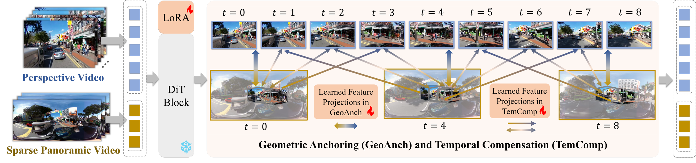

# OmniPersist

**Persistent Dynamic World Modeling via Coupled Panoramic Evolution**

[Zhilu Zhang](https://scholar.google.com/citations?user=8pIq2N0AAAAJ&hl)1,
[Xiaoyu Liu](https://scholar.google.com/citations?user=h4iDziYAAAAJ&hl)2,
[Wenxi Liu](https://scholar.google.com/citations?user=Y310sT0AAAAJ&hl)3,
[Shengfeng He](https://scholar.google.com/citations?user=rBWnK8wAAAAJ&hl)1,*

1 Singapore Management University · 2 Harbin Institute of Technology · 3 Fuzhou University 
* Corresponding author

**[Project](https://omnipersist.github.io/)** · **arXiv** <!-- arXiv URL: -->

## Overview

OmniPersist is a single-stage video diffusion framework for camera-controlled world modeling. It jointly generates perspective video and a temporally sparse 360° panoramic stream so that moving subjects can continue evolving outside the camera's field of view and remain consistent when the camera returns.

Given a text prompt, an observed perspective image or video prefix, and a camera trajectory with known intrinsics, the model predicts both streams in a single denoising process. It requires no initial panoramic image, auxiliary depth input, or auxiliary generative model at inference.

## Key Features

- **Coupled panoramic evolution:** Dense perspective video and sparse panoramic states share one video diffusion backbone, providing context for content outside the current viewport.
- **Geometric Anchoring (GeoAnch):** Explicit geometric correspondences support feature exchange between perspective and panoramic views at synchronized timestamps.
- **Temporal Compensation (TemComp):** Local feature aggregation across neighboring timestamps bridges the different frame rates of the two streams.

## Method overview

*Dense perspective observations and sparse panoramic states evolve together. The diagram illustrates a panoramic sampling interval of s = 4.*

The perspective stream follows the prescribed camera trajectory, while the panoramic stream models how the surrounding scene evolves, including moving subjects outside the current viewport. Both streams are generated together, allowing the visible view to draw on broader scene context when the camera turns away and returns.

GeoAnch keeps the two views spatially aligned at shared timestamps, and TemComp connects observations across time. Together, they support consistent subject identity and plausible motion while allowing the panoramic stream to run at a lower frame rate.

## Selected Results

The following results are reported in the manuscript at panoramic sampling interval **s = 4**. Each baseline uses the same dataset, Wan2.2-TI2V-5B backbone, and LoRA configuration as its OmniPersist counterpart.

### Image-to-video

| Method | FVD ↓ | Translation error ↓ | Rotation error ↓ | Re-entry identity ↑ | Subject trajectory error ↓ |
| --- | ---: | ---: | ---: | ---: | ---: |
| CameraCtrl | 288.5 | 0.531 | 13.086 | 0.2325 | 0.4753 |
| CameraCtrl + OmniPersist | **262.3** | **0.399** | **5.556** | **0.3355** | **0.3830** |
| UCPE | 333.7 | 0.431 | 8.127 | 0.2097 | 0.4897 |
| UCPE + OmniPersist | **272.7** | **0.376** | **4.976** | **0.3694** | **0.3791** |

### Video continuation

| Method | FVD ↓ | Translation error ↓ | Rotation error ↓ | Re-entry identity ↑ | Subject trajectory error ↓ |
| --- | ---: | ---: | ---: | ---: | ---: |
| CameraCtrl | 227.5 | 0.451 | 11.704 | 0.2494 | 0.5161 |
| CameraCtrl + OmniPersist | **194.9** | **0.401** | **4.345** | **0.3771** | **0.4289** |
| UCPE | 264.6 | 0.443 | 6.711 | 0.2778 | 0.5255 |
| UCPE + OmniPersist | **210.3** | **0.342** | **4.169** | **0.3849** | **0.4245** |

Re-entry identity measures foreground DINOv2 feature similarity when subjects return to view. Subject trajectory error measures normalized subject trajectory deviation from ground truth.
